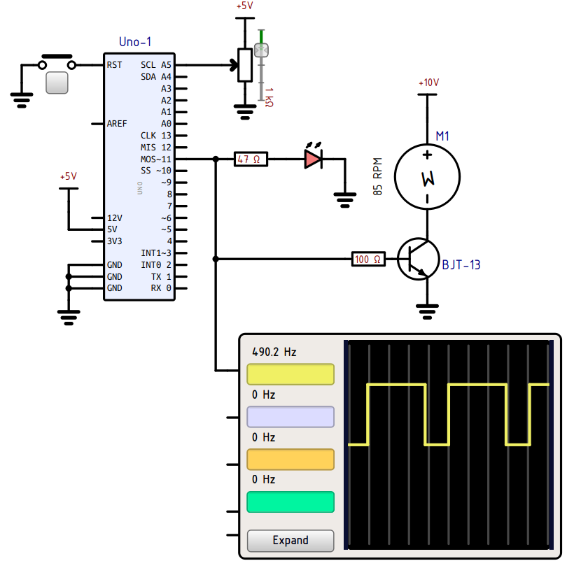

# SimulIDE-Edu-Si

**Pedagoška prilagoditev simulatorja SimulIDE za pouk elektronike v osnovni šoli in pripravo učnih gradiv.**

Projekt temelji na [SimulIDE avtorja Arcachofo / Santiaga Gonzáleza](https://github.com/Arcachofo/SimulIDE-dev). Ta samostojni fork prilagaja predvsem videz shem: preglednejše simbole, ozadje za tisk in prikaz delovanja med simulacijo. Privzeta razvojna veja je **`education`**.

Ime Si označuje slovenski pedagoški kontekst; uporabniški vmesnik ni preveden v slovenščino. Prilagojeni simboli se zgledujejo po IEEE simbolih; projekt ne zagotavlja popolne skladnosti s standardom.

## Pedagoške prilagoditve

- **Ozadje sheme:** v svetli temi lahko izberete belo ali drugo barvo risalne površine. Nastavitev se ohrani ob naslednjem zagonu.
- **LED:** poenostavljen diodni simbol brez črnega kroga. Trikotnik je pri ugasnjeni LED prozoren, med svetenjem pa se zapolni glede na barvo in intenziteto.
- **Napajalni potencial (Rail):** kratka črta z oznako dejanske napetosti, na primer `+5V`, `-5V` ali `0V`.
- **DC motor:** manjši krožni simbol s črko `M` ter oznakama polaritete znotraj kroga. Med simulacijo se črka vrti glede na izračunano hitrost, ob simbolu pa je prikazan RPM. Položaj in orientacija napisa se prilagajata rotaciji motorja.
- **Stikala, tipke in relejni kontakti:** kontaktna mesta so označena z belimi krožci s črnim robom, tudi pri večpolnih izvedbah.
- **Priključne črte komponent:** širina 1,6 je usklajena z običajnimi povezovalnimi žicami.

Prilagoditve ohranjajo obstoječe električne modele in položaje priključkov. Vezja z ustreznimi komponentami ob odpiranju dobijo novi videz. Nekatere sličice komponent v knjižnici še prikazujejo izvirne simbole.

## Primer sheme



Shema med simulacijo prikazuje belo ozadje brez mreže, poenoteno debelino priključnih črt, prilagojene simbole LED in napajalnih potencialov, kontaktne krožce potisne tipke ter motor z animirano črko M in podatkom o hitrosti. Osciloskop prikazuje krmilni signal.

## Zagon v Windows

> več sreče prihodnjič - 😀 

Za Windows potrebujete posebej prevedeno različico programa z datoteko `simulide.exe`. Izvršna datoteka, prevedena v Linuxu, v Windows ne deluje neposredno. Pedagoška različica je bila doslej preverjena v Linuxu; prevajanje in delovanje v Windows še nista preverjena.

### Prevajanje iz izvorne kode (Win)

> Več sreče prihodnjič - 😄

Če pripravljenega paketa še ni, je treba vejo `education` prevesti v Windows. Projekt uporablja qmake in Qt 5 ter prevajalske zastavice GCC, zato je smiselno izhodišče **Qt Creator s kompletom Qt 5 za MinGW**. Potrebne module Qt najdete v spodnjem seznamu odvisnosti za Linux; projekt poleg njih povezuje tudi zlib (`-lz`).

V Qt Creatorju odprite `build_XX/SimulIDE_Build.pro`, izberite ustrezen komplet Qt 5 / MinGW in konfiguracijo **Release**. To je izhodišče za pripravo Windows različice, ne preizkušen postopek za ta fork; morebitne prilagoditve gradnje je treba še preveriti.

Za uporabo na računalniku brez razvojnega okolja mora pripravljavec paketa poleg programa vključiti njegove podatkovne datoteke, knjižnice Qt in vtičnike. Orodje [windeployqt](https://wiki.qt.io/Deploy_an_Application_on_Windows) pomaga zbrati odvisnosti Qt; uporabiti je treba različico iz istega kompleta Qt 5, s katerim je bil program preveden. Paket je treba nato preizkusiti še na računalniku brez nameščenega razvojnega okolja.

## Prevajanje v Linuxu

Potrebujete Git, prevajalnik C++, Make ter razvojna orodja in knjižnice **Qt 5**:

- qmake in orodja Qt, vključno z `lrelease`;
- Core, Gui, Widgets, Xml, Concurrent in Network;
- Svg, Multimedia in SerialPort.

Imena paketov so odvisna od distribucije. Uporabite qmake za Qt 5.

```bash
git clone --branch education https://github.com/davidrihtarsic/SimulIDE-Edu-Si.git
cd SimulIDE-Edu-Si/build_XX
qmake
make -j4
```

Rezultat je v mapi `build_XX/executables/SimulIDE_2.0.0-/`. Ime izhodne mape se lahko pri prihodnjih različicah spremeni.

Po spremembi izvorne kode v obstoječi lokalni kopiji ponovno izvedite `make -j4` v mapi `build_XX`. Če se spremeni konfiguracija projekta, pred tem ponovno izvedite tudi `qmake`.

## Zagon v Linuxu

Iz mape `build_XX` zaženite:

```bash
./executables/SimulIDE_2.0.0-/simulide
```

Za prenos programa na drug računalnik ohranite celotno izhodno mapo skupaj s podatki in drugimi priloženimi datotekami. Na ciljnem sistemu morajo biti nameščene ustrezne izvajalne knjižnice Qt 5; za večpredstavnostne funkcije so lahko potrebni tudi vtičniki Qt Multimedia.

## Priprava sheme za učna gradiva

1. V nastavitvah programa izberite temo **Light**.
2. Pri **Canvas Background** izberite belo barvo. **Reset** povrne izvirno barvo ozadja.
3. Za čisto risalno površino izključite **Draw Grid**.
4. Za prikaz osnovnih simbolov ustavite simulacijo. Pri motorju so takrat podatki RPM skriti, črka `M` pa je pokončna.

## O izvirnem SimulIDE

SimulIDE je simulator elektronskih vezij v realnem času za učenje in eksperimentiranje z analogno in digitalno elektroniko ter mikrokrmilniki. Podpira med drugim PIC, AVR in Arduino. Vključuje tudi urejevalnik kode ter možnosti prevajanja in razhroščevanja za podprta orodja.

- [Izvorni repozitorij](https://github.com/Arcachofo/SimulIDE-dev)
- [Repozitorij pedagoške različice](https://github.com/davidrihtarsic/SimulIDE-Edu-Si)

## Avtorstvo in licence

Izvirni projekt in navedbe njegovih avtorjev so ohranjeni. Pedagoško prilagoditev razvija David Rihtaršič s pomočjo Codexa.

Obstoječa datoteka [copyright.txt](copyright.txt) navaja GNU AGPL različice 3 za datoteke Santiaga Gonzáleza ter GNU GPL različice 3 za prispevke drugih avtorjev, z možnostjo uporabe poznejše različice skladno z navedenimi pogoji. Podrobnosti so v [copyright.txt](copyright.txt), [COPYING](COPYING) ter posameznih datotekah in priloženih knjižnicah. Ohranite licenčne in avtorske navedbe.

Program je na voljo brez jamstva, skladno z navedenimi licencami.


